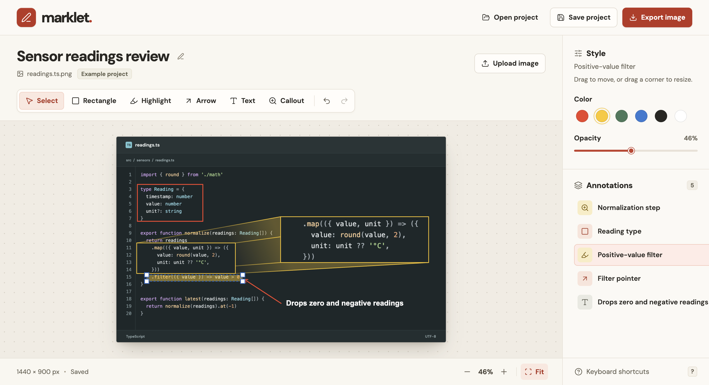

# Marklet

Marklet is a browser-based screenshot annotation editor. Open an image, press **C**, and drag a box around the code you want to magnify. The **3D** callout style links the enlarged inset to the original lines with a four-corner fade.


Add outlined boxes, highlights, arrows, and text to explain the rest of the screenshot. Select an annotation to edit it or click its name in the sidebar to rename it.



Export a PNG or JPEG to share, or save a **.marklet** project to keep editing later.

## Run locally

```sh
npm install
npm run dev
```

Open the local URL printed by Vite. Marklet starts with a TypeScript example you can try.
