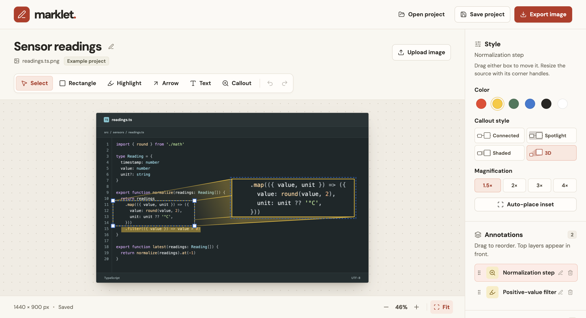

# Marklet

[](https://github.com/williamcotton/marklet/actions/workflows/desktop.yml)

Marklet is a desktop and web app for annotating screenshots. Open an image, press **C**, and drag a box around the code you want to magnify. The **3D** callout style links the enlarged inset to the original lines with a four-corner fade.

## Download

- [Windows x64 installer](https://github.com/williamcotton/marklet/releases/latest/download/Marklet-windows-x64.exe)
- [macOS Apple Silicon disk image](https://github.com/williamcotton/marklet/releases/latest/download/Marklet-mac-arm64.dmg)
- [macOS Intel disk image](https://github.com/williamcotton/marklet/releases/latest/download/Marklet-mac-x64.dmg)
- [Linux x64 AppImage](https://github.com/williamcotton/marklet/releases/latest/download/Marklet-linux-x86_64.AppImage)

See the [latest release](https://github.com/williamcotton/marklet/releases/latest) for release notes. The macOS builds are ad-hoc signed without Apple notarization. The Windows installer is unsigned.



Add outlined boxes, highlights, arrows, and text to explain the rest of the screenshot. Select an annotation to edit it or click its name in the sidebar to rename it. Drag a layer by its handle to move it forward or backward in the stack.


Open a **.webstamp** file to annotate its capture. **Source details** shows the captured URL and timestamp. A saved **.marklet** project contains the editable layers, the original capture, and an annotated image. Export PNG or JPEG for use outside Evidence Works.

## Run from source

With Node.js 24 installed, start the desktop app:

```sh
npm ci
npm run desktop
```

For the web app, run `npm run dev` and open the local URL printed by Vite. Marklet starts with a TypeScript example you can try.

GitHub Actions builds the desktop packages on pushes to `main`. A version tag that matches `package.json` publishes the installers to GitHub Releases.
